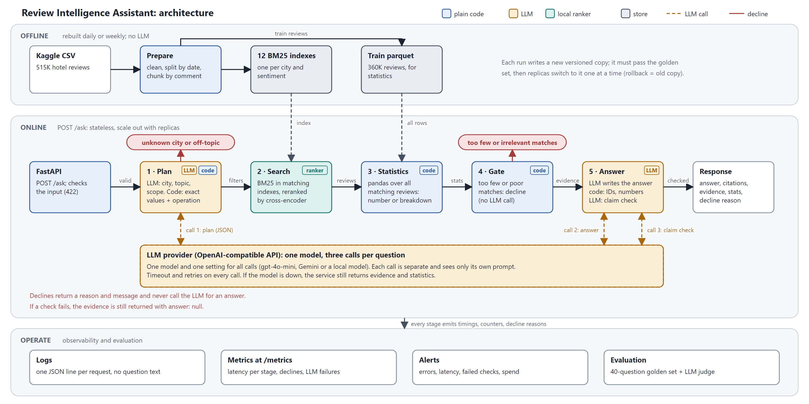

# Review Intelligence Assistant

A FastAPI service that answers natural-language questions about 515K European hotel reviews. Every answer cites the reviews it came from, numbers are computed over all matching reviews rather than a sample, and when the data cannot support an answer the service says so instead of guessing.

```
POST /ask {"question": "What do Australian guests say about Amsterdam hotels?"}
```



Design, tradeoffs and diagram: [`DESIGN.md`](DESIGN.md) and [`docs/architecture.pdf`](docs/architecture.pdf). One question traced end to end: [`WALKTHROUGH.md`](WALKTHROUGH.md). Monitoring and evaluation plan: [`EVAL_AND_MONITORING.md`](EVAL_AND_MONITORING.md). 515K to 50M reviews: [`SCALING.md`](SCALING.md).

## Quick start

Python 3.11. About 1 GB of disk (dataset and indexes ~400 MB, ranking model ~150 MB). Internet is needed once for the dataset and the ranking model.

```bash
python -m venv .venv
.venv\Scripts\activate            # macOS/Linux: source .venv/bin/activate
pip install -r requirements.txt

python main.py                    # download, clean and split, build the search indexes (a few minutes)
uvicorn app.api:app               # serve on http://localhost:8000
```

`main.py` skips any step whose output already exists; `python main.py --rebuild` redoes all of them. Without an LLM configured the service runs in retrieval-only mode (see below), so it works straight away.

**Kaggle:** the dataset is [`jiashenliu/515k-hotel-reviews-data-in-europe`](https://www.kaggle.com/datasets/jiashenliu/515k-hotel-reviews-data-in-europe). If `kagglehub` asks for credentials, create a Kaggle API token and set `KAGGLE_USERNAME` and `KAGGLE_KEY`, or download `Hotel_Reviews.csv` yourself into `data/raw/` and run `python main.py` again.

## Try it

```bash
curl -X POST localhost:8000/ask -H "Content-Type: application/json" \
  -d '{"question": "How friendly is the staff in Paris hotels?"}'
```

## API contract

| Endpoint | Purpose |
|---|---|
| `POST /ask` | Ask a question |
| `GET /health` | 200 once the indexes, statistics and ranker have loaded and warmed up; 503 otherwise |
| `GET /metrics` | Prometheus metrics |
| `GET /docs` | Interactive OpenAPI docs |

**Request** (`POST /ask`, JSON). Only `question` is required. Explicit filters override what is read from the question.

| Field | Type | Rules |
|---|---|---|
| `question` | string | 3-500 characters |
| `top_k` | integer | 1-50, default 10: number of evidence reviews returned |
| `city` | string | optional; one of Amsterdam, Barcelona, London, Milan, Paris, Vienna |
| `nationality` | string | optional; as spelled in the dataset, e.g. `Australia` |
| `months` | list of integers | optional; each 1-12 |
| `sentiment` | `"positive"` or `"negative"` | optional; search only that side |

**Response** (200). A real response from the local `qwen2.5:3b` model, with the evidence list shortened:

```json
{
  "answer": "Friendly is mentioned in both positive and negative comments, with a higher proportion in positive comments (94.3%).",
  "citations": [
    {
      "review_id": 250411,
      "snippet": "Friendly atmosphere Feels like you re staying in a friend..."
    },
    {
      "review_id": 220746,
      "snippet": "Most the staff were really friendly but the manager wasn..."
    }
  ],
  "evidence": [
    {
      "review_id": 250411,
      "text": "Friendly atmosphere Feels like you re staying in a friend s apartment",
      "sentiment": "positive",
      "hotel": "H tel Arvor Saint Georges",
      "city": "Paris",
      "reviewer_nationality": "France",
      "review_month": 8,
      "review_year": 2015,
      "reviewer_score": 10.0,
      "bm25_score": 0.96,
      "rerank_score": 4.39
    },
    "... (top_k items)"
  ],
  "stats": {
    "reviews_matched": 41607,
    "avg_reviewer_score": 8.43,
    "data_scope": "train split, reviews from 2015-08-04 to 2017-01-02",
    "operation": null,
    "topic_breakdown": {
      "term": "friendly",
      "reviews_in_scope": 41607,
      "reviews_mentioning": 8186,
      "mention_rate": 0.197,
      "positive_share_of_mentions": 0.943,
      "negative_share_of_mentions": 0.057,
      "summary": "8,186 of 41,607 reviews (19.7%) mention 'friendly'. Of the mentions, 7,773 (94.3%) are in the guest's POSITIVE comment (what they liked) and 468 (5.7%) in the NEGATIVE comment (what they disliked)."
    }
  },
  "filters_applied": {
    "city": [
      "Paris"
    ]
  },
  "insufficient_evidence": false,
  "reason": null,
  "unsupported_claims_removed": 0,
  "message": null,
  "latency_ms": 3416.8
}
```

| Field | Meaning |
|---|---|
| `answer` | The cited answer. `null` in retrieval-only mode, when the question is declined, or when a check fails (the evidence is still returned) |
| `citations` | Reviews the answer cites: ID and first 10 words |
| `evidence` | The retrieved reviews given to the model, with the scores that ranked them |
| `stats` | Numbers computed over all matching reviews: the requested operation, or a topic breakdown |
| `filters_applied` | The exact filters the search used |
| `insufficient_evidence`, `reason`, `message` | Set when the service declines (below) |
| `unsupported_claims_removed` | Sentences the claim check deleted from the answer |
| `latency_ms` | Total server time. About 3 s here, most of it the local model |

**Declined questions** return 200 with `insufficient_evidence: true`, no answer, a `message` and a `reason`, and never call the LLM for an answer:

| `reason` | When | `evidence` and `stats` |
|---|---|---|
| `unsupported_city` | The question names a city that is not in the data | empty |
| `off_topic` | The question is not about hotel guest feedback (the planner's judgement) | empty |
| `too_few_results` | Fewer than 3 reviews match the filters | the few matches and the statistics are still returned |
| `low_relevance` | The best reranked result scores below the cutoff (skipped when a number was asked) | empty |

For example, "What do guests say about hotels in Rome in spring?":

```json
{"answer": null, "citations": [], "evidence": [], "stats": null,
 "filters_applied": {"review_month": [3, 4, 5]},
 "insufficient_evidence": true, "reason": "unsupported_city",
 "message": "No reviews for Rome; the dataset covers Amsterdam, Barcelona, London, Milan, Paris, Vienna."}
```

**Errors** all share one body, `{"error": "...", "detail": "..."}`:

| Status | When | `error` |
|---|---|---|
| 422 | Invalid input, for example a question under 3 characters | `invalid_request`; `detail` names each bad field |
| 422 | A `city` or `nationality` filter that is not in the data | `unknown_filter_value` |
| 503 | Indexes not built or not loaded (run `python main.py`, then restart) | `index_unavailable` |
| 500 | Unexpected failure | `internal_error`; the cause is in the logs, keyed by the `X-Request-ID` response header |

Example questions: *What do Australian guests say about Amsterdam hotels? Is the staff friendly in Paris? What do guests say about noise in London in June? What do guests say about hotels in Rome in spring?* (Rome is not in the data, so it is declined and the six covered cities are listed: Amsterdam, Barcelona, London, Milan, Paris, Vienna.)

## Choosing a language model

The model writes the final answer and helps read the question. Everything else is plain code, so the service answers without it. The client speaks the OpenAI API, so any compatible model works. Copy `.env.example` to `.env` and pick one:

| Option | Settings |
|---|---|
| Nothing | Leave blank: you get evidence and statistics, `answer: null` |
| Local Ollama (free) | `ollama pull qwen2.5:3b`, then `LLM_BASE_URL=http://localhost:11434/v1`, `LLM_MODEL=qwen2.5:3b`, `LLM_TIMEOUT=120` |
| Gemini free tier | `GEMINI_API_KEY=...` (about 20 requests a day per model, so enough only for a quick try) |
| OpenAI `gpt-4o-mini` (the brief's model) | `LLM_BASE_URL=https://api.openai.com/v1`, `LLM_API_KEY=...`, `LLM_MODEL=gpt-4o-mini` |

The prototype was developed and evaluated with `qwen2.5:3b`; a stronger model improves answer wording, not the retrieval or the numbers. Optional switches: `RERANK=0`, `VERIFY_CLAIMS=0` (skip the claim-check LLM pass), `LLM_PLANNER=0` (rule-based question parser instead of the LLM).

## Tests and evaluation

```bash
pytest                                        # 85 tests, offline, no data or network needed (~15 s)
python scripts/run_golden.py --no-llm         # 40-question golden set against the real index, no LLM
python scripts/run_golden.py --no-llm --check eval/golden_baseline.json   # fails if any layer regresses
python scripts/run_questions.py eval/questions.csv eval/results.csv       # questions -> answers (needs an LLM)
python scripts/judge_answers.py eval/results.csv eval/judged.csv          # LLM-as-judge on those answers
```

The golden set checks each layer separately (decline reason, filters, aggregate, the number recomputed independently with pandas, evidence validity). It is small and written by the developer, so treat it as a regression guard, not proof of quality. See [`EVAL_AND_MONITORING.md`](EVAL_AND_MONITORING.md).

## Environment and assumptions

- **Hardware:** built and measured on one desktop (6 cores, 16 GB RAM, no GPU needed for the service; the local LLM used a GPU).
- **Speed:** about 0.3-0.4 s per question without an LLM (BM25 ~7 ms, statistics 25-55 ms, rerank 230-390 ms); 5-6 s with a free hosted model.
- **Data:** only the training split is indexed (the first 70% of reviews by date, Aug 2015 to Jan 2017). The rest is held out for evaluation; a production build would index everything.
- **Cities:** the dataset covers six cities. Questions about others are declined.
- **Not included:** authentication, rate limiting and a persistent store for logs and metrics. Logs are JSON on stdout (the question text is never logged) and metrics are exposed for a Prometheus scraper.
- **First start:** the first run downloads the ranking model (~150 MB) once.

## Layout

```
main.py             build everything: download, clean and split, index
app/api.py          FastAPI app, error handling, metrics endpoint
app/service.py      the pipeline: plan, retrieve, rerank, statistics, gate, answer
app/planner.py      LLM question reader, with validation and a rule-based fallback
app/query_parser.py, router.py   rules for nationality, months, sentiment, which number to compute
app/bm25_index.py   chunking, index build, filtered search
app/stats.py        pandas statistics over all matching reviews
app/llm.py          LLM client, answer checks (citations, numbers)
app/verifier.py     claim check
app/observability.py  JSON logs and Prometheus metrics
scripts/, eval/     evaluation tools, golden set, sample questions
tests/              unit and API tests
docs/               architecture diagram (PDF, PNG, SVG) and its generator
```
