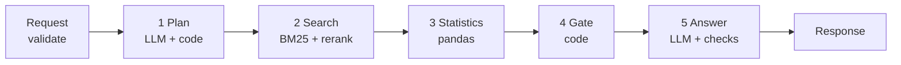

# Walkthrough: how a question becomes an answer

A support agent sends one English question. The service returns a short answer that cites its reviews, the numbers behind it and the reviews it used, or it says there is not enough evidence. This page follows one real question through every stage. Design reasons are in [`DESIGN.md`](DESIGN.md); the architecture diagram is in the [README](README.md).



## The example

```
POST /ask {"question": "Is staff in Paris hotels described as friendly?"}
```

Run on the real index with a local `qwen2.5:3b` model. The values below are real output; times are from that run.

| Stage | What happens | Result here |
|---|---|---|
| **0 Validate** (code) | Check the request: question 3 to 500 characters, `top_k` 1 to 50 (default 10), optional filters. Give the request an ID. | Valid |
| **1 Plan** (LLM call 1, then code, 365 ms) | The model proposes `{"cities": ["Paris"], "topic": "friendly", ...}` from the question alone. Code keeps a city or hotel only if it is real and named in the question. Nationality, months, sentiment and which number to compute come from rules, never from the model. If the LLM fails, a rule-based parser takes over. | Filter `city = Paris`, topic `friendly`, no number asked |
| **2 Search** (BM25 6 ms, rerank 83 ms) | Open the Paris positive and Paris negative indexes. With no side requested, take the best 25 from each side so neither crowds out the other. A cross-encoder reranks them (BM25 scores from different indexes are not comparable) and the top 10 are kept, 5 from each side. | 10 reviews, best rerank score 4.39 |
| **3 Statistics** (pandas, 48 ms) | Over all matching reviews, not the 10: count those whose positive or negative comment has a word starting with the stem `friend`, split by which comment. Code writes one plain summary sentence from the numbers. | 8,186 of 41,607 reviews (19.7%); of the mentions, 94.3% in the positive comment |
| **4 Gate** (code) | Decline instead of answering if the city is unsupported, the question is off topic, fewer than 3 reviews match, or even the best result is irrelevant. No LLM answer call is made when declining. | Passes |
| **5 Answer** (LLM call 2, 1,378 ms) | The prompt holds the question, the statistics (with the summary sentence) and the 10 reviews. The model must copy numbers from the summary, cite review IDs and reply as JSON. | A two-sentence answer citing 6 reviews |
| **5 Checks** (code, then LLM call 3, 407 ms) | Code: every number must appear in the statistics, the evidence or the question, and every cited ID must be one of the 10 reviews. Then a second LLM call labels each sentence supported or not, and unsupported sentences are removed. That check fails open. | All sentences supported |

Total 2.29 s on a small local model; about 94% of it is the three LLM calls. Without the LLM a request takes about 0.3 to 0.4 s.

## The output

```json
{
  "answer": "In the reviews from Paris hotels, staff are described as friendly with 8,186 out of 41,607 (19.7%) ...",
  "citations": [{"review_id": 250411, "snippet": "Friendly atmosphere Feels like you re staying in a friend..."}],
  "evidence": [{"review_id": 250411, "text": "...", "sentiment": "positive", "hotel": "H tel Arvor Saint Georges",
                "city": "Paris", "reviewer_nationality": "France", "review_month": 8, "review_year": 2015,
                "reviewer_score": 10.0, "bm25_score": 0.96, "rerank_score": 4.39}],
  "stats": {"reviews_matched": 41607, "avg_reviewer_score": 8.43,
            "data_scope": "train split, reviews from 2015-08-04 to 2017-01-02",
            "topic_breakdown": {"reviews_mentioning": 8186, "mention_rate": 0.197, "summary": "8,186 of 41,607 ..."}},
  "filters_applied": {"city": ["Paris"]},
  "insufficient_evidence": false, "reason": null, "message": null,
  "unsupported_claims_removed": 0, "latency_ms": 2292.2
}
```

The `X-Request-ID` header ties the response to its JSON log line. Logs never contain the question text. Metrics are at `/metrics`.

## Every way a request can stop

| Situation | Caught at | Caller gets |
|---|---|---|
| Invalid input; explicit `city` or `nationality` not in the data | 0 and 1 | 422 `invalid_request` or `unknown_filter_value` |
| Indexes not loaded; unexpected failure | 0 / anywhere | 503 `index_unavailable`; 500 `internal_error` |
| City not in the data ("hotels in Rome") | 1 | 200, `unsupported_city`, no evidence |
| Not about hotel reviews | 1 | 200, `off_topic`, no evidence |
| Best rerank score below -1.0 | after 2 | 200, `low_relevance`, no evidence |
| Fewer than 3 matching reviews | 4 | 200, `too_few_results`, the few reviews and the statistics |
| LLM down or slow | 1 and 5 | Planner falls back to rules; `answer: null`, evidence and statistics returned |
| Answer has an invented number or citation | 5 | `answer: null`, evidence and statistics returned |
| One sentence is unsupported | 5 | That sentence is removed |

About the -1.0 cutoff: the rerank score is a raw model output with no fixed range (4.39 was a strong match, weak ones scored -2.8). A score of -1.0 corresponds to roughly a 27% chance of being relevant. The cutoff was tuned by hand on about 30 queries and is provisional.

**A real case where a check stopped a bad answer.** For "What do Australian guests say about noise in London in June?" the model wrote "6 out of 32 mentions" and "18.8% negative". The real figures are 16 of 409 reviews and 81.2% negative. The number check found 6 and 32 in none of the sources and dropped the answer. The caller still received the nine evidence reviews and the correct statistics.

## Questions that ask for a number

"How many reviews were left on Hotel Arena?" The rules see "how many" and pick the `count` operation, so stage 3 runs that instead of a topic breakdown. Its sentence is "Review count: at least 293 reviews (only the indexed period is counted)." and the answer copies it. It says "at least" because only the first 70% of reviews by date are indexed; the full CSV has 405 rows for that hotel. In this mode every number in the answer must come from the statistics.

## Who decides what

| Decision | Made by | Why |
|---|---|---|
| Is it about hotel reviews, and what is the topic | LLM, then code checks | Fuzzy language. The topic must survive a check; a 3B model once invented "food" for "Italian guests". |
| City, hotel | LLM proposes, code validates | A 3B model added every city to "how many reviews are from Australia?". |
| Nationality, months, sentiment, which number | Rules | The model wrote "Australian" (not a data value) and turned "at night" into six months. |
| Which reviews to show | BM25 and the reranker | Exact filters, and every result traces to a real review. |
| Counts and averages | pandas over all matching reviews | Counting 10 samples gives a confident wrong number. |
| Whether to answer | Code | No LLM call when the evidence is missing. |
| Wording of the answer | LLM | It sees only the retrieved reviews and the statistics. |
| Are numbers and citations real | Code | Deterministic check. |
| Is each sentence supported | A second LLM call | Code cannot judge meaning. |

## Known weaknesses

- **"Mentions" are word-stem matches.** "Friendly" also matches "friend" and "friends", and synonyms are missed. "Positive" and "negative" mean which comment a word was in, not measured sentiment.
- **BM25 drops "not" and "no" as stop words**, so it cannot tell "friendly" from "not friendly". Splitting each review into its positive and negative comment recovers most of that.
- **Only reviews up to 2017-01-02 are indexed**, so counts are minimums. A production build indexes everything.
- **Which number to compute comes from keyword rules.** "Which city is rated best?" works; "what's the most positively viewed city?" is declined as `low_relevance`.
- **A 3B model sometimes writes a bare number or a slightly wrong description.** The checks catch invented numbers and citations, not every wording slip.
- **The golden set is small and self-written:** a regression guard, not proof of quality.
